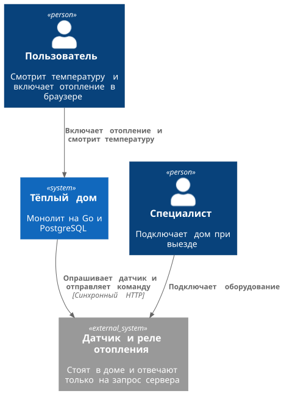
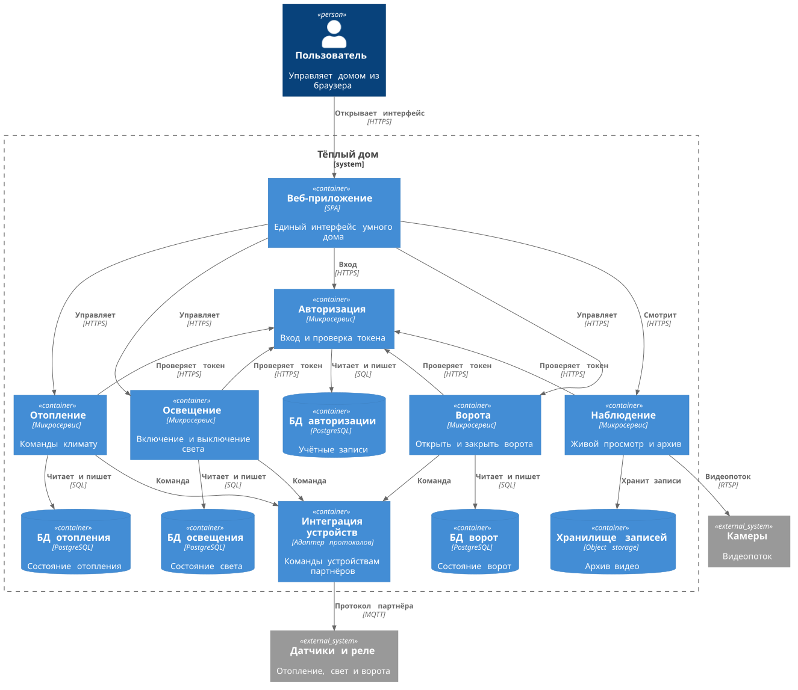
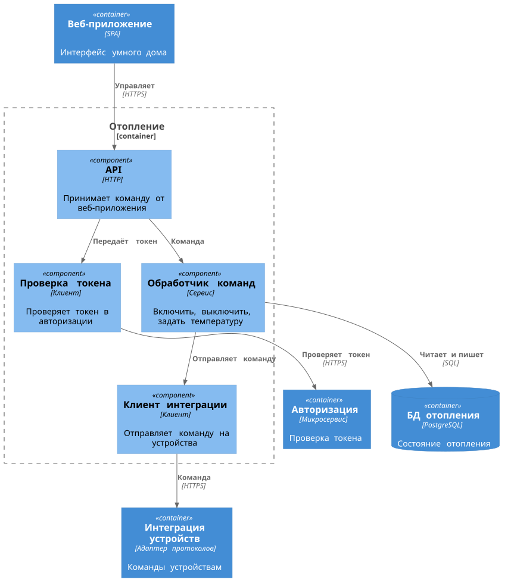
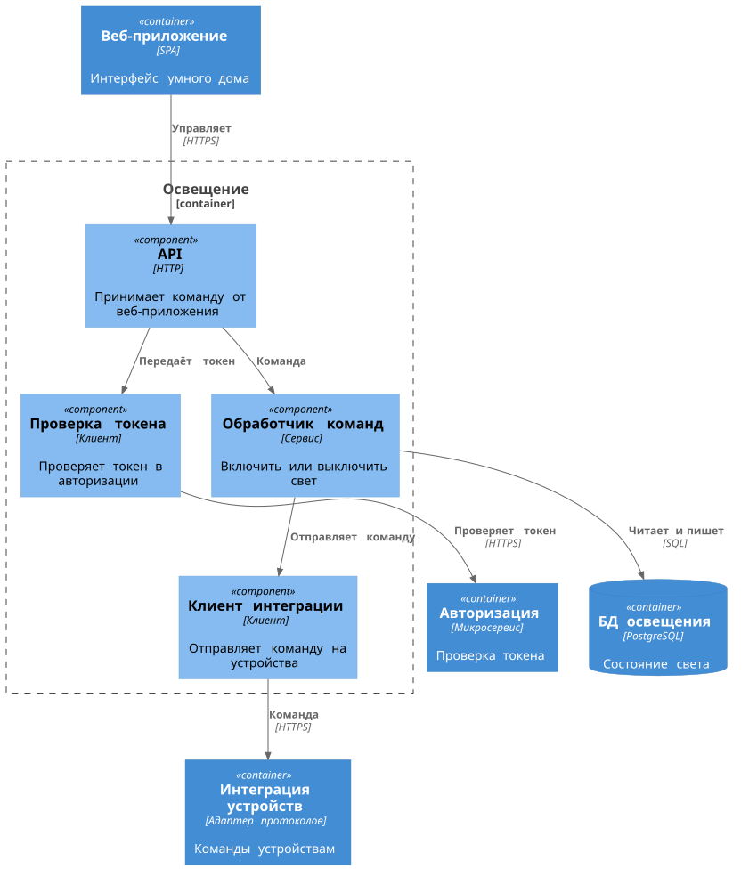
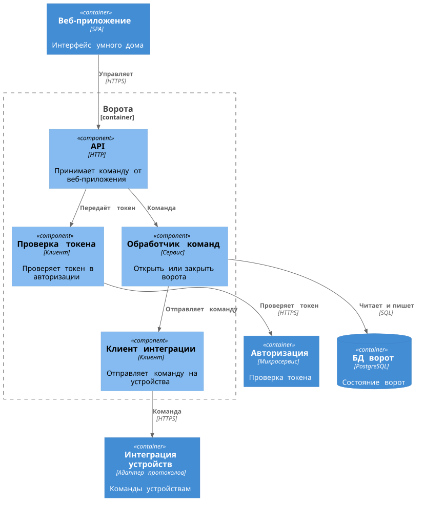
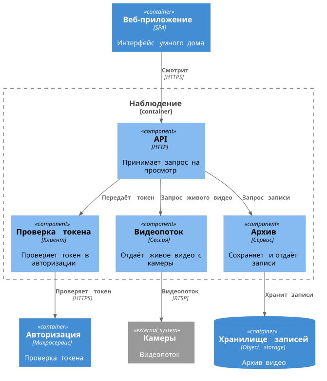
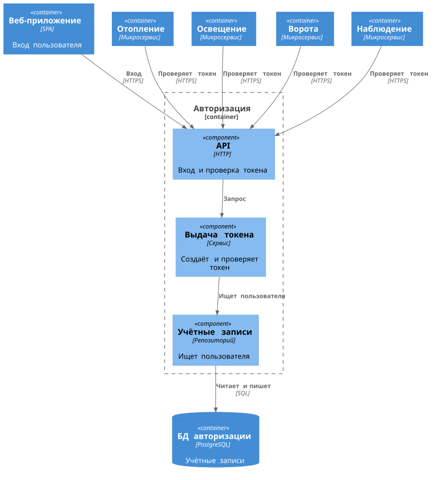
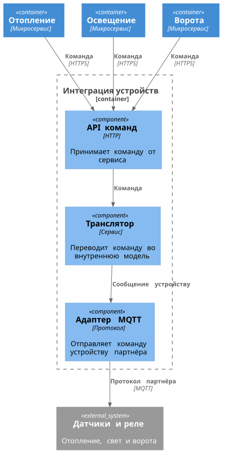
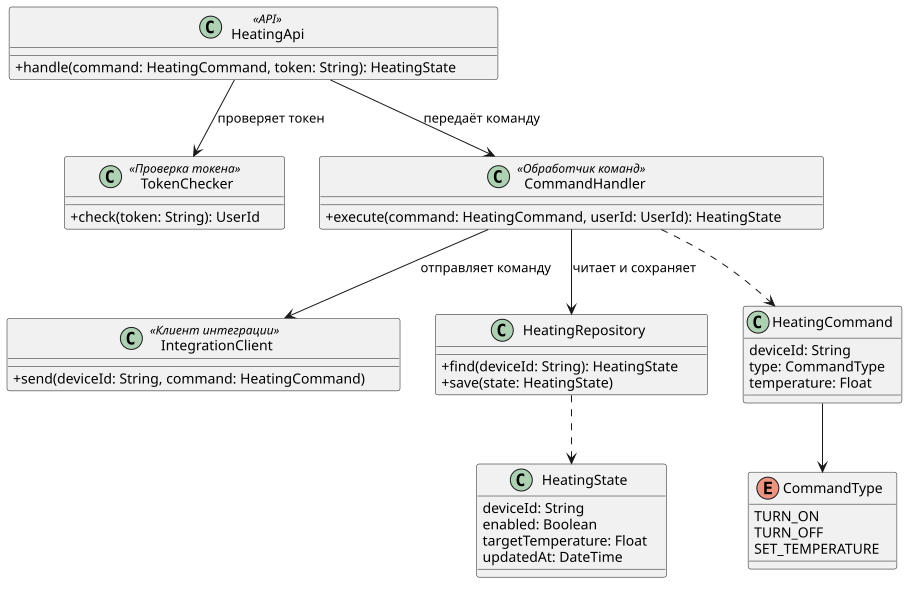
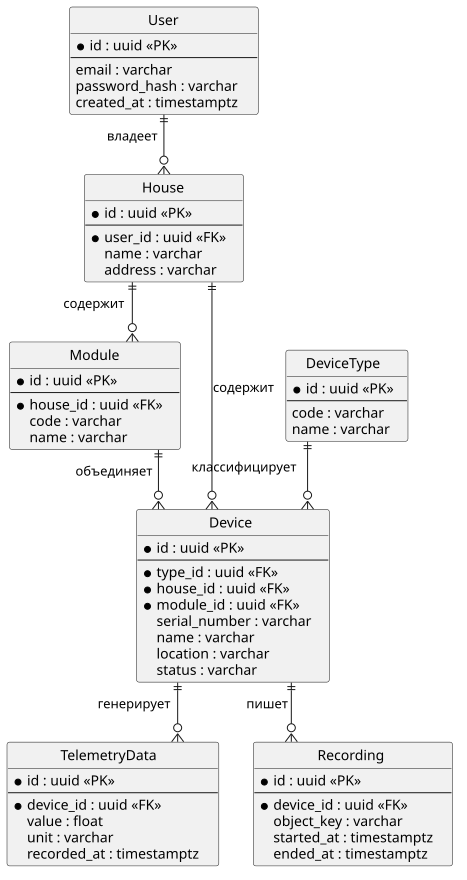

# Project_template

# Задание 1. Анализ и планирование

### 1. Описание функциональности монолитного приложения

**Управление отоплением:**

- Пользователи могут удалённо включать/выключать отопление в своих домах.

**Мониторинг температуры:**

- Система получает данные о температуре с датчиков, установленных в домах. Пользователи могут просматривать текущую температуру в своих домах через веб-интерфейс.

### 2. Анализ архитектуры монолитного приложения

**Язык программирования:**

- Go

**База данных:**

- Postgres

**Архитектура:**

- Монолитная, все компоненты системы (обработка запросов, бизнес-логика, работа с данными) находятся в рамках одного приложения.

**Взаимодействие:**

- Синхронное, запросы обрабатываются последовательно.

**Масштабируемость:**

- Ограничена, так как монолит сложно масштабировать по частям.

**Развертывание:**

- Требует остановки всего приложения.


### 3. Определение доменов и границы контекстов

В текущей реализации существует только один домен: Управление отоплением
Контекст: Один, монолитное приложение без отдельных контекстов

### **4. Проблемы монолитного решения**

- Отопление и чтение температуры нельзя развернуть, масштабировать и чинить отдельно друг от друга.
- Падение общего процесса или базы гасит обе функции сразу.
- Для того чтобы узнать температуру в помещении, нужно каждый раз делать запрос к системе и дожидаться ответа
- Тип датчиков один, который отвечает только за отопление

### 5. Визуализация контекста системы — диаграмма С4



# Задание 2. Проектирование микросервисной архитектуры

В этом задании вам нужно предоставить только диаграммы в модели C4. Мы не просим вас отдельно описывать получившиеся микросервисы и то, как вы определили взаимодействия между компонентами To-Be системы. Если вы правильно подготовите диаграммы C4, они и так это покажут.

**Диаграмма контейнеров (Containers)**



**Диаграмма компонентов (Components)**













**Диаграмма кода (Code)**



# Задание 3. Разработка ER-диаграммы

Логическая модель данных. В реализации таблицы лежат в разных базах: пользователь — в базе авторизации, состояние устройства — в базе его сервиса, измерения и записи камер хранятся отдельно.



# Задание 4. Создание и документирование API

### 1. Тип API

Микросервисы общаются синхронным REST: HTTP и JSON. Контракт описан в OpenAPI.

На диаграмме контейнеров эти вызовы уже помечены HTTPS. Веб-приложение вызывает сервис, сервис проверяет токен в авторизации, сервис отопления, света или ворот отправляет команду в интеграцию. Каждый такой шаг ждёт ответ в том же запросе. Пользователь нажал «включить отопление» и получает новое состояние, а не сообщение «когда-нибудь выполним».

Монолит уже отдаёт JSON по HTTP, путь `/api/v1/sensors`. Новые сервисы продолжают тот же стиль, их можно вызвать из браузера и из Postman. Команде из пяти человек достаточно одного контракта. Поток телеметрии через брокер описывали бы в AsyncAPI, но брокера в схеме контейнеров нет: и команда, и проверка токена заканчиваются ответом.

### 2. Документация API

- [Авторизация](schemas/auth.openapi.yaml)
- [Отопление](schemas/heating.openapi.yaml)
- [Освещение](schemas/lighting.openapi.yaml)
- [Ворота](schemas/gates.openapi.yaml)
- [Наблюдение](schemas/surveillance.openapi.yaml)
- [Интеграция устройств](schemas/integration.openapi.yaml)

# Задание 5. Работа с docker и docker-compose

Перейдите в apps.

Там находится приложение-монолит для работы с датчиками температуры. В README.md описано как запустить решение.

Вам нужно:

1) сделать простое приложение temperature-api на любом удобном для вас языке программирования, которое при запросе /temperature?location= будет отдавать рандомное значение температуры.

Locations - название комнаты, sensorId - идентификатор названия комнаты

```
	// If no location is provided, use a default based on sensor ID
	if location == "" {
		switch sensorID {
		case "1":
			location = "Living Room"
		case "2":
			location = "Bedroom"
		case "3":
			location = "Kitchen"
		default:
			location = "Unknown"
		}
	}

	// If no sensor ID is provided, generate one based on location
	if sensorID == "" {
		switch location {
		case "Living Room":
			sensorID = "1"
		case "Bedroom":
			sensorID = "2"
		case "Kitchen":
			sensorID = "3"
		default:
			sensorID = "0"
		}
	}
```

2) Приложение следует упаковать в Docker и добавить в docker-compose. Порт по умолчанию должен быть 8081

3) Кроме того для smart_home приложения требуется база данных - добавьте в docker-compose файл настройки для запуска postgres с указанием скрипта инициализации ./smart_home/init.sql

Для проверки можно использовать Postman коллекцию smarthome-api.postman_collection.json и вызвать:

- Create Sensor
- Get All Sensors

Должно при каждом вызове отображаться разное значение температуры

Ревьюер будет проверять точно так же.


# **Задание 6. Разработка MVP**

Необходимо создать новые микросервисы и обеспечить их интеграции с существующим монолитом для плавного перехода к микросервисной архитектуре.

### **Что нужно сделать**

1. Создайте новые микросервисы для управления телеметрией и устройствами (с простейшей логикой), которые будут интегрированы с существующим монолитным приложением. Каждый микросервис на своем ООП языке.
2. Обеспечьте взаимодействие между микросервисами и монолитом (при желании с помощью брокера сообщений), чтобы постепенно перенести функциональность из монолита в микросервисы.

В результате у вас должны быть созданы Dockerfiles и docker-compose для запуска микросервисов. 
