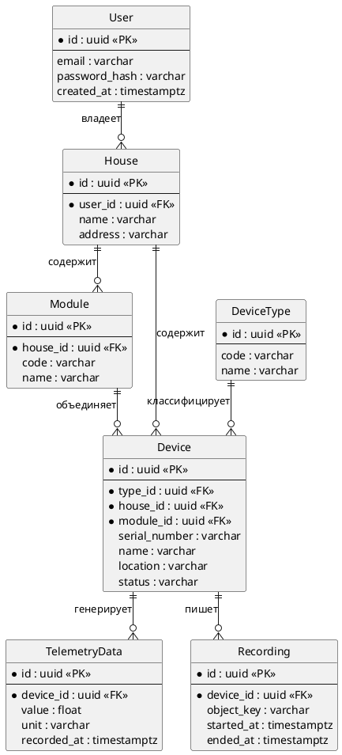

# ER-диаграмма

Логическая модель данных экосистемы. Физически таблицы разъедутся по базам микросервисов: пользователь живёт в базе авторизации, состояние устройства — в базе его сервиса, телеметрия и записи камер хранятся отдельно.

