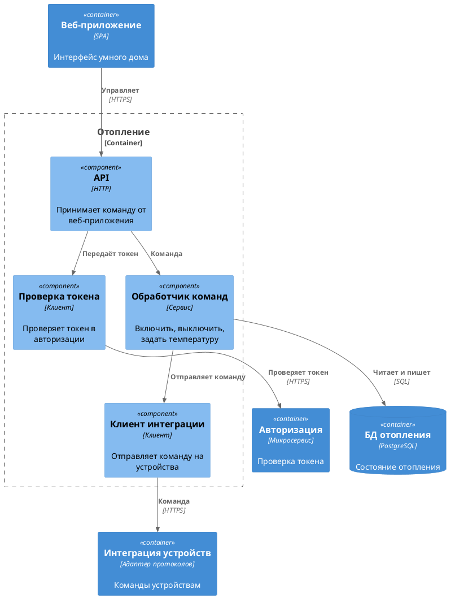
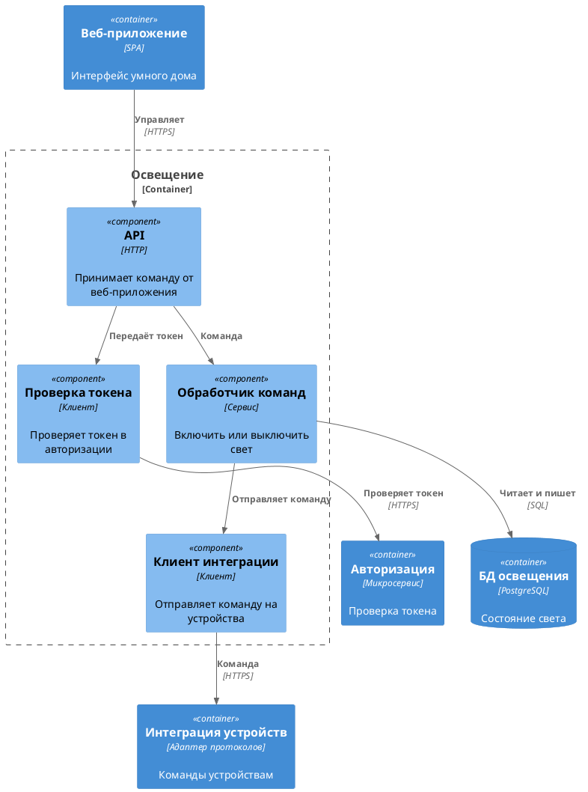
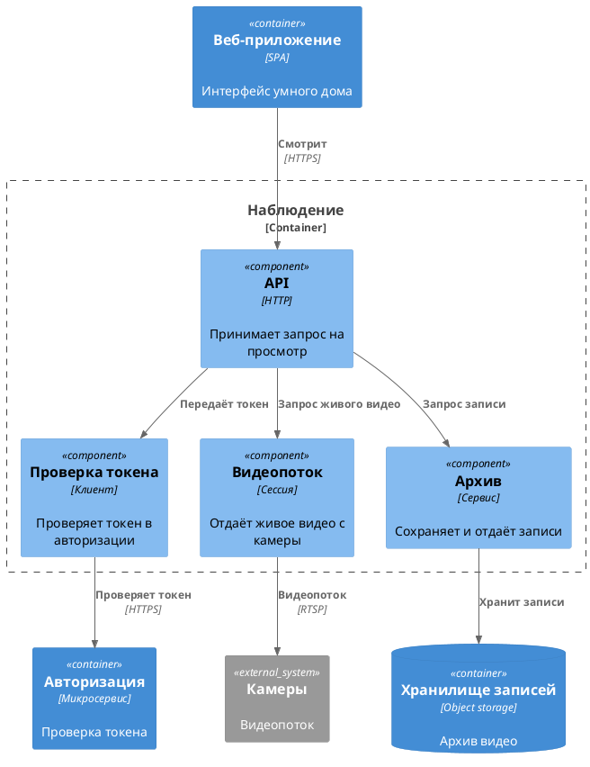
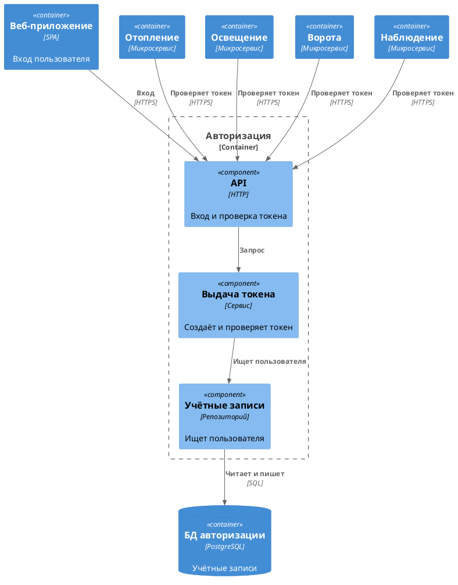
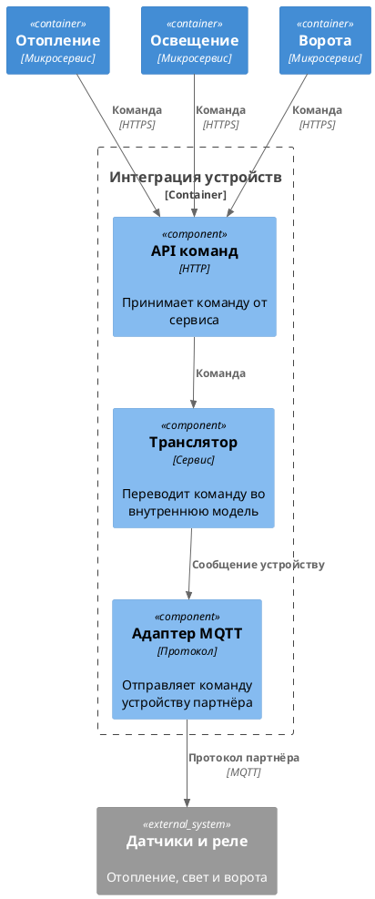

# Диаграмма компонентов

Отопление, освещение и ворота устроены одинаково. Отличается набор команд. Наблюдение, авторизация и интеграция устройств раскрыты отдельно.

## Отопление

## Освещение

## Ворота

## Наблюдение

## Авторизация

## Интеграция устройств

